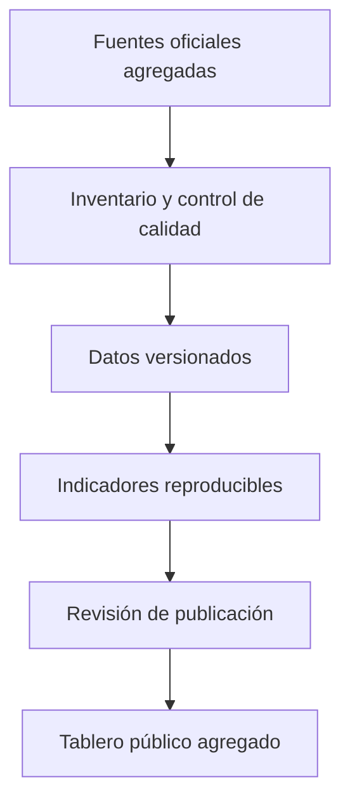

# Especificación técnica y funcional

## A. Resumen ejecutivo

El objetivo es observar la evolución histórica de seguridad, percepción y calidad de denuncia para evaluar políticas preventivas y programas comunitarios. El usuario puede consultar estadísticas comparables con trazabilidad, distinguir unidades y períodos y detectar necesidades de investigación. Las cifras agregadas no sustentan conclusiones sobre individuos ni sustituyen una evaluación causal. El MVP usa la totalidad del distrito y periodos anuales o acumulados publicados. La información territorial se aborda como contexto administrativo para servicios públicos, sin generar clasificaciones operativas ni mapas de vulnerabilidad.

## B. Fuentes
Véase DATA_SOURCES.md. Prioridad: cuadros oficiales agregados con fechas, diccionario y versión; estadísticas de percepción y denuncia; denominadores demográficos; geometrías administrativas para presentación contextual. El acceso institucional y la aprobación de reutilización determinan la ampliación.

## C. Diccionario e integración

| Campo | Tipo | Estado |
|---|---|---|
| indicator | Texto controlado | Observado en publicaciones |
| period_start, period_end | AAAA-MM | Ventana publicada; anual o acumulado |
| value | Decimal | Observado |
| unit | percent / relative_change | Observado, normalizado |
| source | Identificador de entidad | Observado |
| published | AAAA-MM-DD | Observado |
| comparison | Ventana de referencia | Observado cuando aplica |
| scope | Bogotá D.C. | Fijo para MVP |
| count, population, standard_error | Numéricos | Deseados, ausentes en MVP |
| revision_id, extracted_at, definition_version | Texto/fecha | Deseados, para serie agregada |
| geography_version | Texto | Deseado para cartografía administrativa |

Clave lógica: entidad, indicador, periodo inicial/final y unidad. El denominador de una encuesta es su población de referencia, no la población proyectada automáticamente. No se imputan ceros donde faltan registros.

## D. Metodología

1. Registrar URL, fecha de consulta, licencia, versión, periodo y cobertura; adquirir solo cuadros agregados autorizados.
2. Validar esquema, tipos, rango de porcentajes, coherencia temporal, claves duplicadas, compatibilidad de periodos y categorías. Preservar originales autorizados y registrar transformaciones.
3. Comparar ventanas equivalentes. En porcentajes, informar diferencia en puntos porcentuales; en conteos comparables, calcular cambio relativo con denominador previo positivo. Distinguir series de encuesta de registros.
4. Para una serie futura con conteo anual agregado n y población residente N de idéntico periodo y cobertura, tasa por 100.000 = 100000 n/N. Las proyecciones demográficas tienen incertidumbre; la movilidad hace que residentes no equivalgan a exposición.
5. El análisis espacial de servicios comunitarios puede utilizar límites administrativos y cobertura poblacional, con versionado y análisis de sensibilidad al MAUP. El producto público conserva métricas de seguridad a nivel ciudad y no cruza ubicaciones precisas con tiempos, modalidades o recursos operativos.
6. Evaluación de tendencia: comparar periodos completos, cuantificar variación y distinguir cambios de definición y revisión. Para encuestas, usar errores estándar, ponderaciones y diseño muestral de la entidad. Sin esos insumos, no declarar significancia.
7. Evaluación predictiva de datos agregados: validar series históricas suficientemente largas y documentar incertidumbre antes de cualquier estudio de escenarios. El prototipo no entrena pronósticos delictivos; la comparación de modelos puede practicarse con series sintéticas de demanda de servicios comunitarios, usando una referencia de persistencia y validación temporal retrospectiva. Medir MAE y cobertura de intervalos, revisar deriva y comparar frente a la referencia. No publicar resultados de modelos sin evidencia.

## E. Arquitectura

MVP: CSV, Python estándar, pruebas unittest y HTML autocontenido. Piloto: almacenamiento relacional de métricas agregadas, API de consulta de indicadores aprobados, control de versiones, autenticación para edición y bitácora. Cifrado y mínimos privilegios para operación; no se almacenan registros individuales. El frontend no requiere claves ni rastreo de ubicación.

## F. Tablero
Tarjetas con fuente, fecha de publicación y periodo, gráfico de comparación interanual y gráfico de variaciones reportadas. Separación visual por unidades, notas de comparabilidad, enlace a fuentes, diseño responsive y etiquetas textuales accesibles. Filtros de categoría permitidos dentro de estadísticas agregadas. Sin datos suficientes para tasas, mostrar estado pendiente en vez de valor inferido.

## G. Plan por fases

| Fase | Responsable funcional | Dependencia | Aceptación |
|---|---|---|---|
| 0. Prototipo | Datos + producto | Publicaciones verificadas | Cifras, procedencia y pruebas reproducibles |
| 1. Serie validada | Ingeniería de datos | Cuadros agregados y licencia | Fechas/categorías estables y reconciliación documentada |
| 2. Piloto comunitario | Analítica + usuarios | Aprobación de publicación | Interpretación correcta de indicadores y accesibilidad |
| 3. Operación | Mantenedor + revisión | Infraestructura y responsables | Actualización versionada, revisión y auditoría |

## H. Mantenimiento
Revisar publicaciones mensuales; conservar ventanas anteriores y registrar revisiones. Bloquear publicación al cambiar esquema, unidad o denominador. Controlar cobertura, faltantes y discrepancias. Un modelo de demanda de servicios, si procede, se retira cuando falla calibración o pierde utilidad frente a la referencia. Conservar versión previa y justificar cada cambio.

## I. Ejemplos comprobados
La salida HTML muestra las cifras oficiales seleccionadas de 2024, 2025 y enero–septiembre de 2026. Los cambios de encuesta se calculan en puntos porcentuales. Son estadísticas descriptivas y no resultados de un modelo ML.

## J. Pruebas y preguntas pendientes
Validación automática: claves únicas, intervalos válidos, fuente y unidad previstas, porcentajes válidos, comparación anual y salida reproducible. Prueba de revisión humana: el lector distingue percepción de victimización, cambio relativo de puntos porcentuales y periodo de publicación de periodo observado.

Antes de ampliar: ¿qué cuadros agregados tienen cobertura continua, qué definiciones cambiaron, cuáles son definitivos, qué denominadores y errores estándar están disponibles, qué licencia autoriza publicación y quién asumirá revisión institucional?
