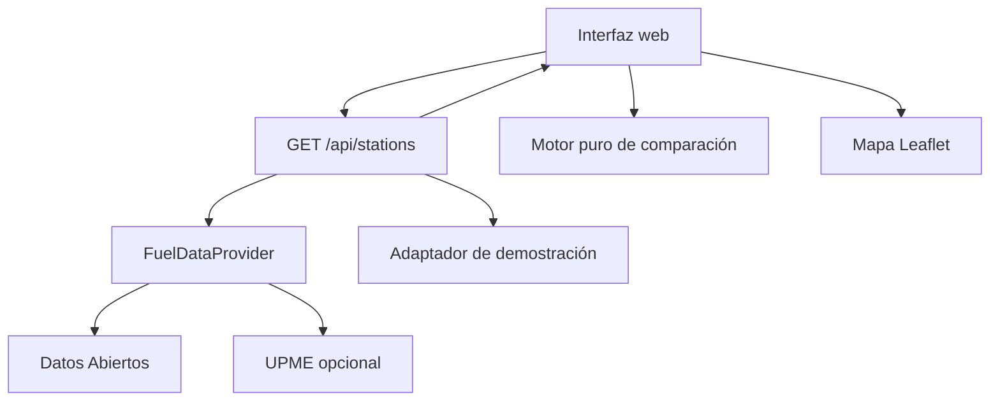

# Arquitectura

El frontend conserva el punto de origen únicamente en memoria. La API valida el código DANE, combustible y modo de datos; el proveedor consulta copias históricas comprobadas y la fuente geográfica opcional, con tiempos de espera y caché de una hora. El motor de decisión no depende de una API ni de React.

El dominio incluye identidad, nombre, municipio, dirección, marca, tipo de producto, precio, fecha o periodo, fuente, categoría de dato y coordenadas opcionales. Las categorías mensual, puntual y demostración se excluyen entre sí. El contrato del proveedor expone país, moneda y unidad. Añadir otro país requiere adaptador de fuente y configuración local.

PostgreSQL/PostGIS se reservaría para almacenamiento histórico autorizado, consultas espaciales y coincidencias entre fuentes. Para el volumen actual una copia histórica y consultas por municipio son suficientes.
